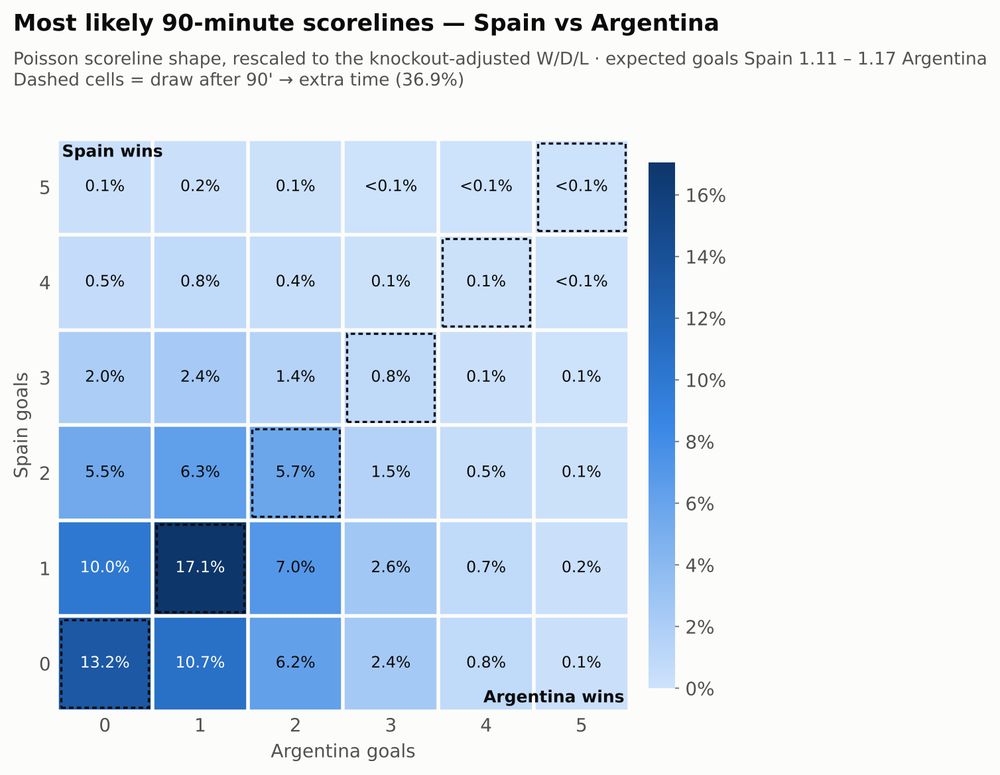
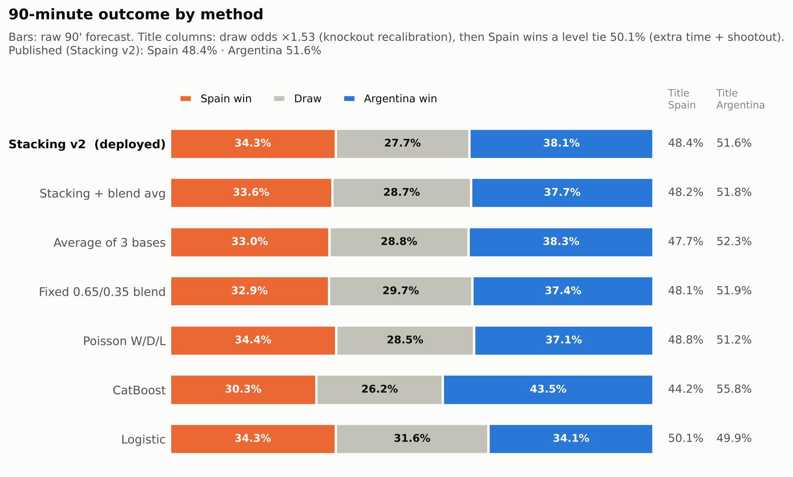
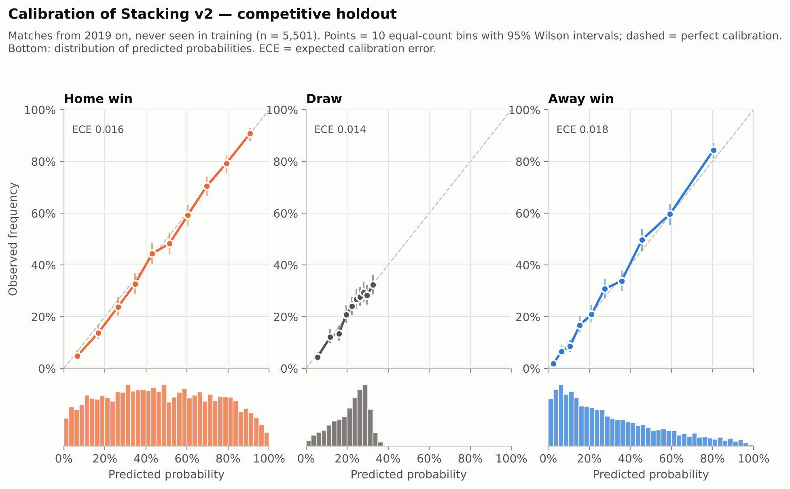
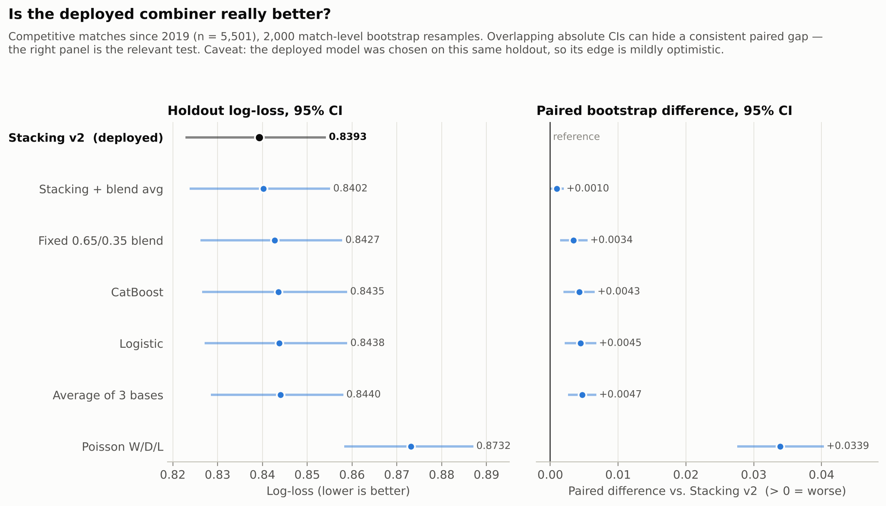
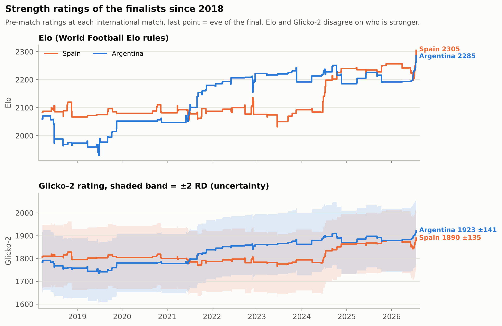

# World Cup 2026 Final Predictor

Machine Learning model predicting the result of the 2026 FIFA World Cup final
(**Spain vs Argentina**, 2026-07-19, East Rutherford), using the history of
~49,500 international matches since 1872 from the
[martj42/international_results](https://github.com/martj42/international_results)
dataset.

## Methodology

Three components, combined into a final ensemble:

1. **Strength ratings: Elo + Glicko-2** (`src/elo.py`, `src/glicko2.py`) —
   the full match history is replayed in chronological order by two
   complementary systems: Elo following the
   [World Football Elo](https://www.eloratings.net/about) rules (K-factor by
   competition importance, goal-difference scaling, home-advantage bonus)
   and **Glicko-2** (Glickman), which besides the rating also estimates each
   team's **RD (rating deviation — uncertainty)** and **volatility**.
   Glicko-2 ignores goal margin and reacts differently to recent runs,
   giving the classifier a second strength signal partially independent
   of Elo.
2. **W/D/L classifier with 3-base stacking** (`src/features.py`,
   `src/combine.py`, `src/train_model.py`) — three base models:

   - multinomial logistic regression and **CatBoost**, both recency-weighted
     (6-year half-life), over leak-free features (Elo diff and level,
     Glicko-2 diff and RD gap, 10-match form, rest days, competition
     importance, neutral venue);
   - **W/D/L probabilities from the Poisson model** (score matrix built
     from expected goals) — a signal only weakly correlated with the two
     rating-driven classifiers, which is exactly the diversity a
     combination needs.

   A **logistic meta-model** combines the three outputs, receiving the
   **log-odds** of the 9 base probabilities + match context (neutral venue,
   competition importance). To train it without leakage, the base models
   are refit on expanding chronological windows (2-year blocks from 2000;
   Poisson on a rolling ~11-year window) and predict only the block
   *after* their training window — 25,513 out-of-sample meta-training
   examples (2000–2026).

   `train_model.py` evaluates four combiners on the temporal holdout
   (train < 2019, validate ≥ 2019) and deploys the one with the lowest
   competitive log-loss:

   | Candidate | Competitive log-loss |
   |---|---|
   | Logistic alone | 0.8438 |
   | CatBoost alone | 0.8433 |
   | Poisson W/D/L alone | 0.8732 |
   | Fixed 0.65/0.35 blend (semifinals baseline) | 0.8427 |
   | Average of the 3 bases | 0.8439 |
   | **Stacking v2 (deployed)** | **0.8391** |
   | Average of stacking + blend | 0.8401 |

   Naive baseline: 1.05. With the third Poisson base, the log-odds and the
   context features, stacking now **beats the fixed blend** (0.8391 vs
   0.8427) — the previous version, a meta-model over raw probabilities of
   two correlated bases, lost to the blend. Caveat: picking the best of 4
   combiners on the holdout is mild selection; the exact margin should be
   read with that grain of salt.
3. **Poisson goal model** (`src/poisson_model.py`) — Dixon-Coles-style
   attack/defense strengths via L2-regularized Poisson regression
   (matches since 2015).

Because a final cannot end in a draw, `src/predict_final.py` turns the
90-minute forecast into a title probability with two knockout adjustments
(`src/knockout.py`), both fit on historical knockouts by the backtest below
(only matches before the final):

- **Knockout draw recalibration**: knockouts are level after 90' more often
  than the all-matches classifier predicts (34.0% observed vs 25.2%), so
  the stacking draw odds are multiplied by **1.53** (maximum likelihood),
  with win/loss rescaled to keep their ratio.
- **Extra time + shootout**: a level tie goes to extra time where each side
  scores Poisson(φ · its 90' expected goals), with **φ = 0.242** fit on 105
  real extra times since 2005 (vs. the naive 30/90 = 0.333: extra time is
  ~27% less productive per minute); still level → a coin flip mildly tilted
  by the Elo gap.

Title = P(win in 90') + P(level after 90') × P(win | level). The Poisson
Monte Carlo (50,000 runs, same φ) is no longer averaged in — it was the
weakest method in the backtest — and is kept for the scoreline matrix
(rescaled to the adjusted W/D/L) and as a reference number.

## Result — Spain vs Argentina

| Signal | Spain | Argentina |
|---|---|---|
| Elo (eve of the final) | 2309 | 2288 |
| Glicko-2 (RD) | 1889 (67) | 1923 (71) |
| Expected goals (Poisson) | 1.11 | 1.17 |
| 90 minutes (stacking v2, raw) | 34.3% | 38.1% (draw 27.7%) |
| 90 minutes (knockout-adjusted) | 29.9% | 33.2% (draw 36.9%) |
| Win a tie level after 90' | 50.1% | 49.9% |
| *Reference: Monte Carlo title* | *48.9%* | *51.1%* |
| *Reference: previous ensemble (MC + stacking)* | *48.6%* | *51.4%* |
| **Title probability** | **48.4%** | **51.6%** |

**Predicted champion: Argentina, by a narrow margin.** Elo and Glicko-2
disagree about who is stronger (Elo gives Spain +21; Glicko-2, which ignores
goal margin and reacts faster to recent runs, gives Argentina +33); the
Poisson model sees a slight Argentine edge in attack. The meta-model, seeing
all three signals, leans toward Argentina.
P(extra time) = 36.9%, P(penalties) = 22.9%.
Most likely 90-minute scores: 1-1 (17.1%), 0-0 (13.2%), 0-1 (10.7%), 1-0 (10.0%).

**What happened:** Spain won 1-0 after extra time (0-0 at 90', Ferran
Torres 106'). The model's call was a near coin flip that went the other way;
the extra-time scenario it now rates at 36.9% is the one that occurred.

Full breakdown in `results/final_prediction.json`.

## Method comparison

Competitive-holdout log-loss (train < 2019, validate ≥ 2019) and each
method's raw 90-minute prediction for the final. The title columns apply
the same knockout adjustment to every method (draw odds ×1.53, then a level
tie goes 50.1% / 49.9% via extra time + shootout):

| Method | Log-loss ↓ | Spain (90') | Draw | Argentina (90') | Title ESP | Title ARG |
|---|---|---|---|---|---|---|
| Logistic | 0.8438 | 34.3% | 31.6% | 34.1% | 50.1% | 49.9% |
| CatBoost | 0.8433 | 30.3% | 26.2% | 43.5% | 44.2% | 55.8% |
| Poisson W/D/L | 0.8732 | 34.4% | 28.5% | 37.1% | 48.8% | 51.2% |
| Fixed 0.65/0.35 blend | 0.8427 | 32.9% | 29.7% | 37.4% | 48.1% | 51.9% |
| Average of the 3 bases | 0.8439 | 33.0% | 28.8% | 38.3% | 47.7% | 52.3% |
| **Stacking v2 (deployed)** | **0.8391** | 34.3% | 27.7% | 38.1% | **48.4%** | **51.6%** |
| Average of stacking + blend | 0.8401 | 33.6% | 28.7% | 37.7% | 48.2% | 51.8% |

## Figures

Generated by `src/plots.py` from the artifacts in `results/`.

| | |
|---|---|
|  |  |
| **90-minute scoreline matrix** (Poisson shape, rescaled to the knockout-adjusted W/D/L); dashed diagonal = draw → extra time. | **Raw W/D/L by method** with the knockout-adjusted title odds. |
|  |  |
| **Calibration** of the deployed combiner on the competitive holdout (ECE ≈ 0.014–0.015 per class). | **Log-loss with 95% bootstrap CIs**: the absolute CIs overlap, but the *paired* difference shows stacking v2 ahead of every other candidate on the same matches (vs. stacking + blend: +0.0011, CI barely above 0). |



**Elo and Glicko-2 since 2018**, with the ±2 RD uncertainty band. The two systems disagree on the eve of the final.

## Knockout backtest (`src/backtest_knockouts.py`)

The W/D/L holdout cannot validate how a draw is turned into a winner, so
the title methods are replayed on real knockout matches (World Cup, Euro,
AFCON, Asian Cup), with every model refit before each edition's first
knockout match. The knockout adjustment's two parameters are re-estimated
before every edition from earlier knockouts only. Target: who advanced.
Paired bootstrap 95% CIs vs. the previously published ensemble.

| Method (who advances, 327 knockouts 2004–2026) | Log-loss ↓ | Δ vs ensemble [95% CI] |
|---|---|---|
| Classifier (stacking v2 + shootout tilt) | 0.5956 | −0.0059 [−0.0126, +0.0007] |
| Monte Carlo (Poisson + extra time + tilt) | 0.6112 | +0.0097 [+0.0029, +0.0165] |
| Ensemble (previous published method) | 0.6015 | — |
| Hybrid (stacking 90' + naive extra-time model) | 0.5951 | −0.0065 [−0.0125, −0.0003] |
| **Knockout-adjusted stacking (deployed)** | **0.5964** | **−0.0051 [−0.0099, −0.0004]** |
| Elo expected score only | 0.5946 | −0.0069 [−0.0224, +0.0089] |

| Sub-model check | Observed | Before | After adjustment |
|---|---|---|---|
| P(level after 90'), 326 knockouts 2004+ | 34.0% | 25.2% (log-loss 0.654) | 33.6% (log-loss 0.640) |
| P(penalties \| extra time), 154 extra times 1986+ | 64.9% | 54.7% (log-loss 0.666) | 58.3% (log-loss 0.653) |

Findings:

- **The Monte Carlo dragged the ensemble down.** It is the weakest method;
  dropping it is the source of the gain over the previous ensemble.
- **Knockout draws were underpredicted** (34.0% level after 90' vs 25.2%);
  the draw recalibration fixes the level (33.6%), which makes P(extra
  time) and P(penalties) honest.
- **Extra time has ~27% fewer goals per minute** than the 90 minutes
  (φ = 0.242 vs 0.333), so more ties reach penalties; still slightly
  underpredicted (58.3% vs 64.9%).
- **The adjustment does not sharpen "who advances"**: deployed vs. the
  unadjusted hybrid is +0.0012 [−0.0013, +0.0036], i.e. a tie. Once level
  after 90' a tie is close to a coin flip (Elo tilt 0.677, extra-time model
  0.676, 50/50 0.693), so moving mass into the draw mostly changes *how*
  a team advances, not *who*. It is deployed for the calibrated
  extra-time/penalty probabilities at no cost in title accuracy.
- Plain Elo is as good as any method on this small sample; the CIs
  (±0.015) are too wide to separate them.

Full output: `results/knockout_backtest.json`, the row-level
`results/knockout_backtest.csv` and the deployed parameters in
`results/knockout_calibration.json`.

## Running it

```bash
pip install -r requirements.txt
cd src
python train_model.py         # trains and saves the stacking classifier
python backtest_knockouts.py  # replays historical knockouts, fits the knockout adjustment (~3 min)
python predict_final.py       # runs the full pipeline, prints + saves the prediction
python plots.py               # renders the figures to results/figures/
```

`results.csv`, `shootouts.csv` and `goalscorers.csv` are downloaded
automatically on first run (results already include the semifinals: Spain
2-0 France, Argentina 2-1 England; the cutoff keeps the final itself out of
every fit).

## Project layout

```
src/data_io.py         dataset download/loading
src/elo.py             Elo rating engine
src/glicko2.py         Glicko-2 rating engine (rating + RD + volatility)
src/features.py        leak-free chronological feature builder
src/combine.py         combiners (blends, stacking) and Poisson W/D/L
src/train_model.py     trains bases + meta, compares combiners, deploys the best
src/poisson_model.py   Dixon-Coles style Poisson goal model
src/predict_final.py   full pipeline -> final prediction
src/plots.py           figures (results/figures/*.png)
src/knockout.py        knockout draw recalibration + extra-time/shootout model
src/backtest_knockouts.py  title-method backtest on historical knockouts
results/               trained model + metrics + prediction (generated)
```

## Caveats

- International football is inherently noisy; ~61% accuracy on a 3-class
  problem is a solid edge over the baseline, not a crystal ball.
- Squad-level factors (injuries, suspensions, travel) are not modeled —
  only team-level Elo, recent form and scoring rates.
- The Elo shootout tilt is a modeling assumption, not fit to historical
  penalty-shootout data (the backtest shows it is about as good as any
  alternative, but the sample is small).

## Credits

Data: [martj42/international_results](https://github.com/martj42/international_results).
