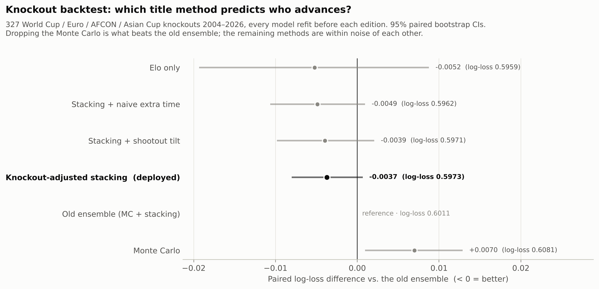
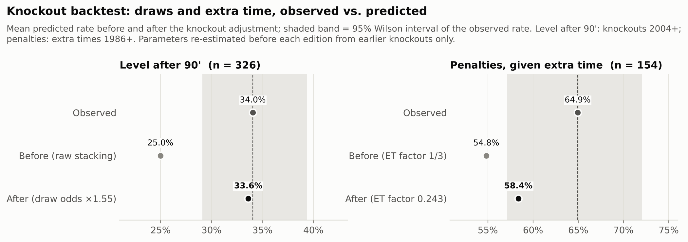

# World Cup 2026 Final Predictor

Machine Learning model predicting the result of the 2026 FIFA World Cup final
(**Spain vs Argentina**, 2026-07-19, East Rutherford), using the history of
~49,500 international matches since 1872 from the
[martj42/international_results](https://github.com/martj42/international_results)
dataset.

| | |
|---|---|
| **Pre-match forecast** (frozen 2026-07-16, tag [`v1.0-pre-final`](https://github.com/valeeeeeeeeeeeeee/2026-world-cup-finals-predictor/tree/v1.0-pre-final)) | Argentina champion, **51.1%** vs Spain 48.9% |
| **Actual result** (2026-07-19) | **Spain 1-0 Argentina** after extra time |

The forecast made before kickoff is kept separate from everything built
after the final: see [Pre-match forecast](#pre-match-forecast) and
[Post-match analysis](#post-match-analysis). The code on `main` is the
**revised** model; `git checkout v1.0-pre-final` restores the exact code and
outputs that produced the original forecast.

## Methodology (current, revised model)

Three components, combined into a final ensemble:

1. **Strength ratings: Elo + Glicko-2** (`src/elo.py`, `src/glicko2.py`) —
   the full match history is replayed in chronological order by two
   complementary systems: Elo following the
   [World Football Elo](https://www.eloratings.net/about) rules (K-factor by
   competition importance — 60 World Cup, 50 continental finals, 40 World
   Cup/continental qualifiers and Nations Leagues, 30 other tournaments,
   20 friendlies — goal-difference scaling, home-advantage bonus)
   and **Glicko-2** (Glickman), which besides the rating also estimates each
   team's **RD (rating deviation — uncertainty)** and **volatility**; RD
   grows while a team is idle (one Glicko-2 inflation step per 30 days
   without a match). Glicko-2 ignores goal margin and reacts differently to recent runs,
   giving the classifier a second strength signal partially independent
   of Elo.
2. **W/D/L classifier with 3-base stacking** (`src/features.py`,
   `src/combine.py`, `src/train_model.py`) — three base models:

   - multinomial logistic regression and **CatBoost**, both recency-weighted
     (6-year half-life), over leak-free features (Elo diff and level,
     Glicko-2 diff and RD gap, 10-match form, rest days, competition
     importance, neutral venue);
   - **W/D/L probabilities from the Poisson model** (score matrix built
     from expected goals) — a signal only weakly correlated with the two
     rating-driven classifiers, which is exactly the diversity a
     combination needs.

   A **logistic meta-model** combines the three outputs, receiving the
   **log-odds** of the 9 base probabilities + match context (neutral venue,
   competition importance). To train it without leakage, the base models
   are refit on expanding chronological windows (2-year blocks from 2000;
   Poisson on a rolling 20-year, recency-weighted window) and predict only the block
   *after* their training window — 25,513 out-of-sample meta-training
   examples (2000–2026).

   `train_model.py` evaluates four combiners on the temporal holdout
   (train < 2019, validate ≥ 2019) and deploys the one with the lowest
   competitive log-loss:

   | Candidate | Competitive log-loss |
   |---|---|
   | Logistic alone | 0.8442 |
   | CatBoost alone | 0.8424 |
   | Poisson W/D/L alone | 0.8681 |
   | Fixed 0.65/0.35 blend (semifinals baseline) | 0.8424 |
   | Average of the 3 bases | 0.8423 |
   | **Stacking v2 (deployed)** | **0.8386** |
   | Average of stacking + blend | 0.8396 |

   Naive baseline: 1.05. With the third Poisson base, the log-odds and the
   context features, stacking now **beats the fixed blend** (0.8386 vs
   0.8424) — the previous version, a meta-model over raw probabilities of
   two correlated bases, lost to the blend. Caveat: picking the best of 4
   combiners on the holdout is mild selection; the exact margin should be
   read with that grain of salt.
3. **Poisson goal model** (`src/poisson_model.py`) — attack/defense
   strengths via L2-regularized Poisson regression (independent Poisson
   goals), fit on a rolling 20-year window with each match weighted by
   0.5 ^ (age / 4 years), so old matches fade out instead of falling off a
   hard window edge. A Dixon-Coles low-score correction is implemented but
   off (it did not help; see [model refinements](#model-refinements-after-the-final)).

> **Added after the final.** The knockout adjustments below were developed
> once the result was known. The pre-match forecast instead averaged the
> stacking classifier with the Poisson Monte Carlo and had no draw
> recalibration.

Because a final cannot end in a draw, `src/predict_final.py` turns the
90-minute forecast into a title probability with two knockout adjustments
(`src/knockout.py`), both fit on historical knockouts by the backtest below
(only matches before the final):

- **Knockout draw recalibration**: knockouts are level after 90' more often
  than the all-matches classifier predicts (34.0% observed vs 25.0%), so
  the stacking draw odds are multiplied by **1.55** (maximum likelihood),
  with win/loss rescaled to keep their ratio.
- **Extra time + shootout**: a level tie goes to extra time where each side
  scores Poisson(φ · its 90' expected goals), with **φ = 0.243** fit on 105
  real extra times since 2005 (vs. the naive 30/90 = 0.333: extra time is
  ~27% less productive per minute); still level → a coin flip mildly tilted
  by the Elo gap.

Title = P(win in 90') + P(level after 90') × P(win | level). The Poisson
Monte Carlo (50,000 runs, same φ) is no longer averaged in — it was the
weakest method in the backtest — and is kept only as a reference number.
The scoreline matrix is the exact Poisson score distribution, rescaled to
the adjusted W/D/L.

## Pre-match forecast

Frozen at tag [`v1.0-pre-final`](https://github.com/valeeeeeeeeeeeeee/2026-world-cup-finals-predictor/tree/v1.0-pre-final)
(commit `7e18df4`, 2026-07-16, three days before the final). These are the
numbers published before kickoff, unchanged; the method at that point was
stacking v2 for the 90 minutes, averaged with the Poisson Monte Carlo for
the title, with draws resolved by an Elo-tilted shootout.

| Signal | Spain | Argentina |
|---|---|---|
| Elo (eve of the final) | 2308 | 2287 |
| Glicko-2 (RD) | 1889 (67) | 1923 (71) |
| Expected goals (Poisson) | 1.12 | 1.17 |
| 90 minutes (stacking v2) | 34.8% | 37.5% (draw 27.7%) |
| Title — Monte Carlo | 48.8% | 51.2% |
| Title — classifier | 48.9% | 51.1% |
| **Title — final ensemble** | **48.9%** | **51.1%** |

**Predicted champion: Argentina, by a narrow margin.** Elo and Glicko-2
disagreed about who was stronger (Elo gave Spain +21; Glicko-2, which ignores
goal margin and reacts faster to recent runs, gave Argentina +34); the
Poisson model saw a slight Argentine edge in attack. The meta-model, seeing
all three signals, leaned toward Argentina.
P(extra time) = 28.6%, P(penalties) = 15.4%.
Most likely 90-minute scores: 1-1 (13.3%), 0-1 (11.9%), 1-0 (11.4%).

Per-method view at the time (competitive-holdout log-loss, train < 2019,
validate ≥ 2019; title columns resolve the draw via the Elo-tilted
shootout):

| Method | Log-loss ↓ | Spain (90') | Draw | Argentina (90') | Title ESP | Title ARG |
|---|---|---|---|---|---|---|
| Logistic | 0.8438 | 34.4% | 31.8% | 33.8% | 50.6% | 49.4% |
| CatBoost | 0.8439 | 28.8% | 29.9% | 41.2% | 44.1% | 55.9% |
| Poisson W/D/L | 0.8728 | 34.5% | 28.5% | 37.1% | 49.0% | 51.0% |
| Fixed 0.65/0.35 blend | 0.8428 | 32.4% | 31.1% | 36.4% | 48.3% | 51.7% |
| Average of the 3 bases | 0.8440 | 32.6% | 30.1% | 37.4% | 47.9% | 52.1% |
| **Stacking v2 (deployed)** | **0.8391** | 34.8% | 27.7% | 37.5% | 48.9% | 51.1% |
| Average of stacking + blend | 0.8402 | 33.6% | 29.4% | 37.0% | 48.6% | 51.4% |
| Monte Carlo (Poisson simulation) | — | — | — | — | 48.8% | 51.2% |
| **Final ensemble (MC + stacking)** | — | — | — | — | **48.9%** | **51.1%** |

The full pre-match output is `results/final_prediction.json` at that tag
(`git show v1.0-pre-final:results/final_prediction.json`).

## Post-match analysis

Everything from here on was done **after** the final, with the result
known. It evaluates the pre-match forecast and documents a revised model;
the revision is not a forecast and should not be read as one.

### What happened

Spain won 1-0 after extra time (0-0 at 90', Ferran Torres 106').

| Pre-match claim | Outcome | Comment |
|---|---|---|
| Argentina champion, 51.1% | Spain won | A near coin flip that went the other way. Log-loss on this one match: 0.716 vs 0.693 for a 50/50 call. |
| P(extra time) = 28.6% | Extra time happened | Plausible, but the knockout backtest below shows level-after-90' was systematically underpredicted. |
| P(penalties) = 15.4% | No penalties | — |

A single match cannot validate or refute a probabilistic model; the
[knockout backtest](#knockout-backtest-srcbacktest_knockoutspy) over 327
historical knockouts is the meaningful check.

### Revised model (current code)

What the current code on `main` outputs for the same fixture, with the
knockout adjustments added after the final. Ratings differ slightly from
the pre-match run: it was re-run on a later snapshot of the dataset, and two
Elo K-factor fixes now follow the World Football Elo table: continental
qualifiers (Euro, AFCON, Asian Cup, Gold Cup qualification) get K = 40
instead of 50, and other tournaments (regional cups such as the CECAFA, Gulf
or AFF cups, invitationals) K = 30 instead of 40. The Poisson model is
recency-weighted over a rolling 20-year window and Glicko-2 inflates the RD
of idle teams (see [model refinements](#model-refinements-after-the-final)).

| Signal | Spain | Argentina |
|---|---|---|
| Elo (eve of the final) | 2298 | 2279 |
| Glicko-2 (RD) | 1992 (79) | 2024 (84) |
| Expected goals (Poisson) | 1.11 | 1.17 |
| 90 minutes (stacking v2, raw) | 35.4% | 36.8% (draw 27.8%) |
| 90 minutes (knockout-adjusted) | 30.8% | 32.0% (draw 37.3%) |
| Win a tie level after 90' | 50.0% | 50.0% |
| *Reference: Monte Carlo title* | *48.8%* | *51.2%* |
| *Reference: previous ensemble (MC + stacking), re-run* | *49.2%* | *50.8%* |
| **Title probability** | **49.4%** | **50.6%** |

The revision mainly changes *how* a team wins (P(extra time) 28.6% → 37.3%,
P(penalties) 15.4% → 23.1%). The title stays a near coin flip with
Argentina nominally ahead by 1.2 points — well inside the model's
uncertainty. (Before the model refinements it read 49.99% / 50.01%; the
recency-weighted Poisson gives Argentina a slightly better attack again,
1.11 vs 1.17 expected goals.) Most likely 90-minute scores: 1-1 (17.4%),
0-0 (13.4%), 0-1 (10.3%), 1-0 (10.2%).

Full breakdown in `results/final_prediction.json`.

### Model refinements (after the final)

Three refinements to known weaknesses of the base models. Every parameter
was chosen on **pre-2019 data only**, so the 2019+ holdout and the knockout
backtest stay out-of-sample tests:

| Change | Selection (pre-2019) | Chosen |
|---|---|---|
| Poisson: recency weights 0.5 ^ (age / half-life) over a 20-year window, instead of an unweighted 11-year window | Yearly refits 2008–2018, each predicting the next 12 months: W/D/L log-loss 0.9078 → 0.9012 (half-life 3 y 0.9015, 6 y 0.9020) | **4-year half-life** |
| Poisson: Dixon-Coles low-score correction (weighted MLE of ρ) | Same folds: ρ ≈ −0.056, log-loss change < 0.0005; it pushes the draw rate past the observed one (24.0% vs 23.5%) | **implemented, off** |
| Glicko-2: one RD inflation step (paper step 6) per N idle days, capped at RD 350 | Glicko-2's own predictive log-loss on 2000–2018 matches: 0.5623 (none) → 0.5593 (14 d 0.5603, 90 d 0.5599) | **30 days** |

The recency weights also remove the window-edge sensitivity: moving the
window start by 6.5 months now shifts the final's expected goals by ≤ 0.001
per side (it was up to 0.025).

Out-of-sample effect on the 2019+ competitive holdout (5,501 matches,
paired bootstrap 95% CIs vs. the previous model):

| Model | Before | After | Δ [95% CI] |
|---|---|---|---|
| Poisson W/D/L | 0.8732 | 0.8681 | **−0.0051 [−0.0074, −0.0027]** |
| CatBoost (uses Glicko-2 RD) | 0.8437 | 0.8424 | −0.0013 [−0.0032, +0.0006] |
| Logistic (uses Glicko-2 RD) | 0.8438 | 0.8442 | +0.0004 [−0.0014, +0.0022] |
| **Stacking v2** | **0.8391** | **0.8386** | −0.0005 [−0.0022, +0.0012] |

The recency-weighted Poisson is a clear improvement on its own; the
idle-time RD is neutral for the classifiers; the stacked model improves only
marginally (within noise), because the meta-model already leaned on the
rating-based bases. On the knockout backtest the deployed method is
unchanged within noise (0.5977 → 0.5973).

### Method comparison (revised model)

Competitive-holdout log-loss (train < 2019, validate ≥ 2019) and each
method's raw 90-minute prediction for the final. The title columns apply
the same knockout adjustment to every method (draw odds ×1.55, then a level
tie goes 50.0% / 50.0% via extra time + shootout):

| Method | Log-loss ↓ | Spain (90') | Draw | Argentina (90') | Title ESP | Title ARG |
|---|---|---|---|---|---|---|
| Logistic | 0.8442 | 33.8% | 30.8% | 35.5% | 49.3% | 50.7% |
| CatBoost | 0.8424 | 35.3% | 26.4% | 38.3% | 48.7% | 51.3% |
| Poisson W/D/L | 0.8681 | 34.4% | 28.5% | 37.1% | 48.8% | 51.2% |
| Fixed 0.65/0.35 blend | 0.8424 | 34.3% | 29.2% | 36.5% | 49.1% | 50.9% |
| Average of the 3 bases | 0.8423 | 34.5% | 28.5% | 37.0% | 48.9% | 51.1% |
| **Stacking v2 (deployed)** | **0.8386** | 35.4% | 27.8% | 36.8% | **49.4%** | **50.6%** |
| Average of stacking + blend | 0.8396 | 34.9% | 28.5% | 36.6% | 49.2% | 50.8% |

### Figures

Generated by `src/plots.py` from the artifacts in `results/`.

| | |
|---|---|
|  |  |
| **90-minute scoreline matrix** (exact Poisson shape, rescaled to the knockout-adjusted W/D/L); dashed diagonal = draw → extra time. | **Raw W/D/L by method** with the knockout-adjusted title odds. |
|  |  |
| **Calibration** of the deployed combiner on the competitive holdout (ECE ≈ 0.014–0.017 per class). | **Log-loss with 95% bootstrap CIs**: the absolute CIs overlap, but the *paired* difference shows stacking v2 ahead of every other candidate on the same matches, except stacking + blend (+0.0011, CI ≈ [0.000, +0.002], a near tie). |


**Elo and Glicko-2 since 2018**, with the ±2 RD uncertainty band. The two systems disagree on the eve of the final.

### Knockout backtest (`src/backtest_knockouts.py`)

The W/D/L holdout cannot validate how a draw is turned into a winner, so
the title methods are replayed on real knockout matches (World Cup, Euro,
AFCON, Asian Cup), with every model refit before each edition's first
knockout match. The knockout adjustment's two parameters are re-estimated
before every edition from earlier knockouts only. Target: who advanced.
Paired bootstrap 95% CIs vs. the previously published ensemble.

| Method (who advances, 327 knockouts 2004–2026) | Log-loss ↓ | Δ vs ensemble [95% CI] |
|---|---|---|
| Classifier (stacking v2 + shootout tilt) | 0.5971 | −0.0039 [−0.0098, +0.0021] |
| Monte Carlo (Poisson + extra time + tilt) | 0.6081 | +0.0070 [+0.0010, +0.0129] |
| Ensemble (previous published method) | 0.6011 | — |
| Hybrid (stacking 90' + naive extra-time model) | 0.5962 | −0.0049 [−0.0106, +0.0010] |
| **Knockout-adjusted stacking (deployed)** | **0.5973** | **−0.0037 [−0.0080, +0.0007]** |
| Elo expected score only | 0.5959 | −0.0052 [−0.0193, +0.0088] |



| Sub-model check | Observed | Before | After adjustment |
|---|---|---|---|
| P(level after 90'), 326 knockouts 2004+ | 34.0% | 25.0% (log-loss 0.655) | 33.6% (log-loss 0.641) |
| P(penalties \| extra time), 154 extra times 1986+ | 64.9% | 54.8% (log-loss 0.669) | 58.4% (log-loss 0.656) |



Findings:

- **The Monte Carlo dragged the ensemble down.** It is the weakest method
  and the only one clearly separated from the ensemble (its CI excludes 0);
  dropping it is the source of the ~0.004 gain over the previous ensemble,
  although that gain's CI now just includes 0.
- **Knockout draws were underpredicted** (34.0% level after 90' vs 25.0%);
  the draw recalibration fixes the level (33.6%), which makes P(extra
  time) and P(penalties) honest.
- **Extra time has ~27% fewer goals per minute** than the 90 minutes
  (φ = 0.243 vs 0.333), so more ties reach penalties; still slightly
  underpredicted (58.4% vs 64.9%).
- **The adjustment does not sharpen "who advances"**: deployed vs. the
  unadjusted hybrid is +0.0012 [−0.0018, +0.0039], i.e. a tie. Once level
  after 90' a tie is close to a coin flip (Elo tilt 0.678, extra-time model
  0.675, 50/50 0.693), so moving mass into the draw mostly changes *how*
  a team advances, not *who*. It is deployed for the calibrated
  extra-time/penalty probabilities at no cost in title accuracy.
- Plain Elo is as good as any method on this small sample; the CIs
  (±0.015) are too wide to separate them.

Full output: `results/knockout_backtest.json`, the row-level
`results/knockout_backtest.csv` and the deployed parameters in
`results/knockout_calibration.json`.

## Running it

Requires Python 3.13 (see `.python-version`); `requirements.txt` pins the
exact library versions `results/classifier.joblib` was saved with, and the
pickle may not load under other scikit-learn/CatBoost versions.

```bash
pip install -r requirements.txt
cd src
python train_model.py         # trains and saves the stacking classifier
python backtest_knockouts.py  # replays historical knockouts, fits the knockout adjustment (~3 min)
python predict_final.py       # runs the full pipeline, prints + saves the prediction
python plots.py               # renders the figures to results/figures/
```

`results.csv`, `shootouts.csv` and `goalscorers.csv` are downloaded
automatically on first run from a pinned commit of the data repository
(`DATA_COMMIT` in `src/data_io.py`) and checked against SHA-256 hashes, so
re-runs see exactly the same data (results already include the semifinals: Spain
2-0 France, Argentina 2-1 England; the cutoff keeps the final itself out of
every fit).

Tests (no dataset download needed; they run on synthetic data):

```bash
pip install -r requirements-dev.txt
python -m pytest
```

They cover the Glicko-2 worked example from Glickman's paper, known Elo
K-factors and goal-difference multipliers, `poisson_wdl` normalization,
edge cases of `recalibrate_draw`/`title_prob`, and leakage: flipping a
match's result must not change that match's (or any earlier match's)
features.

To inspect or re-run the original pre-match forecast:

```bash
git checkout v1.0-pre-final
```

Re-running it today downloads a newer snapshot of the dataset, so ratings
can shift slightly; the committed `results/` at that tag are the published
numbers.

## Project layout

```
src/data_io.py         dataset download/loading
src/elo.py             Elo rating engine
src/glicko2.py         Glicko-2 rating engine (rating + RD + volatility)
src/features.py        leak-free chronological feature builder
src/combine.py         combiners (blends, stacking) and Poisson W/D/L
src/train_model.py     trains bases + meta, compares combiners, deploys the best
src/poisson_model.py   recency-weighted Poisson goal model (optional Dixon-Coles)
src/predict_final.py   full pipeline -> final prediction
src/plots.py           figures (results/figures/*.png)
src/knockout.py        knockout draw recalibration + extra-time/shootout model
src/backtest_knockouts.py  title-method backtest on historical knockouts
tests/                 pytest suite (rating engines, probabilities, leakage)
results/               trained model + metrics + prediction (generated)
```

## Caveats

- International football is inherently noisy; ~61% accuracy on a 3-class
  problem is a solid edge over the baseline, not a crystal ball.
- Squad-level factors (injuries, suspensions, travel) are not modeled —
  only team-level Elo, recent form and scoring rates.
- The Elo shootout tilt (Elo gap / 1200) is a modeling assumption rather
  than a fitted parameter, but it agrees with the data: on 694 historical
  shootouts the maximum-likelihood divisor is ≈1640 (log-loss 0.6878 vs
  0.6885 for 1200 and 0.6931 for a fair coin).
- The Poisson goal model is an independent-Poisson (Maher) model with
  attack/defense strengths. The Dixon-Coles correction did not improve it
  on pre-2019 data and is off; the knockout draw underprediction is
  knockout-specific (the all-matches Poisson draw rate is already close to
  the observed one) and is handled by the knockout recalibration instead.
- Glicko-2's idle-time RD inflation is one paper step-6 update per 30 days
  without a match; it improves Glicko-2's own predictions but is neutral for
  the classifiers that use RD as a feature.
- `results.csv` records knockout scores after extra time, so the W/D/L
  target is "result after extra time" for the ~0.3% of matches decided in
  extra time (146 known cases, 31 since 2019) — negligible for the
  classifier, and the knockout draw factor is fit on the true 90' state.

## Credits

Data: [martj42/international_results](https://github.com/martj42/international_results).
